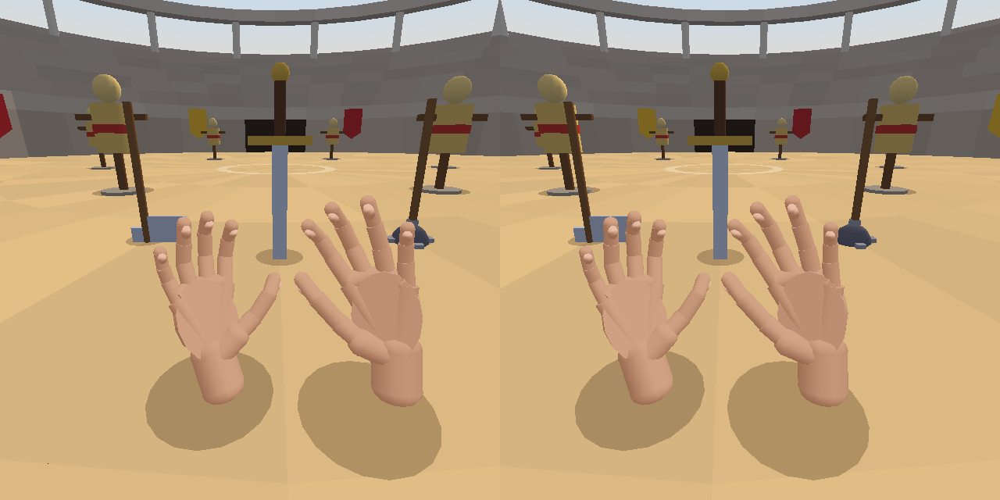

# Mini Pots — rastreamento de mão

Jogo Android nativo em Kotlin. A câmera mostra o ambiente, uma mesa virtual é desenhada por cima e você mexe nos potinhos com a **própria mão**, rastreada pelo MediaPipe Hand Landmarker. Não há mais mapeamento de ambiente (ARCore): o app não procura planos, não precisa do Google Play Services para RA e funciona em qualquer Android 7.0+ com câmera.

A sessão é temporária; potes e objetos não são salvos entre execuções.

## Como jogar

1. Instale o APK e autorize a câmera. Apoie o celular ou segure-o com uma mão e mostre a outra para a câmera traseira, a uns 30–60 cm. O botão **Câmera ⟲** troca para a câmera frontal (imagem espelhada).
2. O esqueleto da mão aparece sobre a imagem. O cursor fica entre o polegar e o indicador; o círculo na mesa mostra onde ele aponta.
3. **Pinça** (encostar polegar e indicador) faz o papel do dedo na tela:
   - pinça rápida = toque;
   - segurar a pinça e mover = arrastar.
4. Em **+ Potinho**, faça a pinça sobre a mesa. Pinça rápida em um pote abre ou fecha a tampa (ou use **Tampa**).
5. Escolha **Bola**, **Cubo**, **Moeda**, **Estrela** ou **Pedra** e faça a pinça em um pote aberto para guardar, ou na mesa para deixar fora.
6. Segure a pinça em um objeto para carregá-lo; solte sobre um pote aberto para guardar. Segurar a pinça em um pote o arrasta.
7. **Mover pote**, **Cor**, **−**, **+**, **Girar**, **Retirar** e **Excluir** agem no objeto selecionado, ou no pote se nenhum objeto estiver selecionado. Até 6 potes, 12 objetos por pote.

Tocar na tela continua funcionando exatamente como a pinça.

No canto superior direito ficam os números de desempenho: `fps` da tela, `mão N Hz` (resultados de rastreamento por segundo), o custo em milissegundos de cada quadro rastreado e onde as redes estão rodando (`CPU` ou `GPU`).

**CPU ou GPU é escolhido pelo próprio app, medindo no seu aparelho.** Com a mão à vista, ele mede por alguns segundos quanto custa cada quadro na CPU. Se a CPU já acompanha a câmera (menos de 28 ms por quadro), fica nela. Se não, ele testa a GPU: o esqueleto da mão fica parado por alguns segundos enquanto a GPU é preparada, e depois a medição se repete. A GPU só fica se o custo por quadro cair pelo menos 15% **e** o `fps` do jogo não cair mais de 10%; senão o app volta para a CPU. Um aviso mostra os números medidos e a escolha fica guardada para as próximas vezes.

O botão **CPU ⇄ GPU** troca na mão, encerra a medição automática e também fica guardado. Se a GPU não puder ser usada, o app volta para a CPU sozinho; se o app fechar enquanto a GPU é ligada (driver com defeito), na próxima abertura ele fica na CPU e avisa. Para repetir a medição automática, limpe os dados do app.

Se o custo por quadro é baixo e mesmo assim `mão N Hz` fica em 22 ou menos, quem limita é a câmera (ela reduz as imagens por segundo com pouca luz). O app avisa quando percebe isso: mais luz resolve, trocar de processador não.

## Coliseu (para óculos VR Box)

O botão **Coliseu** (última fileira do Mini Pots) abre um segundo jogo; o botão **Potinhos** volta. Ele foi feito para o celular dentro de um óculos do tipo VR Box: a tela fica deitada e mostra a arena **duas vezes, uma para cada olho**. A imagem da câmera não aparece; a câmera traseira serve para seguir **as duas mãos**, e os sensores de movimento seguem a cabeça.



*A imagem acima é da versão anterior, ainda sem os braços.*

*Imagem gerada no computador pelo código de desenho do próprio jogo, com mãos lidas de fotografias pelo MediaPipe. Não é captura de tela de um celular.*

**Antes de pôr o celular no óculos** (toque na tela esconde e mostra os botões):

- **VR: ligado/desligado** troca entre as duas imagens e uma imagem só (para jogar com o celular na mão).
- **DIP − / DIP +** ajusta a distância entre os olhos (52 a 74 mm; o comum é 63). O botão do meio mostra os valores e, tocado, volta ao padrão.
- **Escala − / Escala +** ajusta a distância da lente à tela (28 a 70 mm), que é o que decide o tamanho com que o mundo aparece. Se tudo parecer grande demais, aumente; pequeno demais, diminua.
- **Olhar** escolhe como a cabeça é seguida (abaixo). **Recentrar** faz da direção atual a "frente".

**Com o óculos no rosto**, as teclas de volume fazem o que os dedos não alcançam: **volume +** recentra a vista, **volume −** mostra ou esconde os botões.

- **Mãos:** cada mão real aparece como uma mão 3D na cor da pele, com palma, dedos de três ossos e unhas. Ela fica onde a mão real está na frente da câmera, à esquerda ou à direita, perto ou longe. Uma mão que a câmera perde continua no lugar por cerca de 1 segundo (mais em celular lento, até 2 segundos), ficando cinza aos poucos, e só depois some; no lugar dela aparece um ponto âmbar embaixo, do lado da mão que falta. A mão nunca é desenhada onde ela não foi vista.
- **Braços:** cada mão tem um braço na mesma cor, do ombro ao cotovelo e do cotovelo ao pulso. O ombro fica um pouco abaixo e ao lado da cabeça e gira com o corpo; o cotovelo dobra para fora e para baixo. Só a mão é vista pela câmera: o braço é calculado a partir dela. Se a mão for mais longe do que o braço alcança, o braço estica em vez de se soltar da mão.
- **Andar (como no Gorilla Tag):** não há pernas nem botão de andar. Olhe para o chão, encoste uma mão nele (aparece um círculo claro embaixo da mão) e puxe: o corpo vai para o lado contrário ao da mão. Puxar para trás anda para frente, empurrar para baixo levanta o corpo, e um empurrão rápido vira pulo ou deslize. As duas mãos valem, juntas ou alternadas, e também dá para se apoiar no muro e nos bonecos. A sombra de cada mão mostra a que altura ela está.
- **Pegar, sem segurar:** encoste a mão, aberta ou fechada, no cabo da espada, do machado ou da maça fincados na areia. A arma gruda na mão e fica nela; não é preciso manter a mão fechada. Para **largar**, feche a mão e abra de novo; se a mão estiver em movimento ao abrir, a arma é **arremessada**. A arma largada só volta para a mesma mão depois que a mão se afasta dela. Dá para segurar uma arma em cada mão. Se a câmera perder a mão no meio de um golpe, a arma não cai.
- **Bater:** balance a arma através de um boneco de palha. Só conta golpe rápido; encostar devagar não faz nada. Três golpes (ou menos, se forem fortes) desmontam o boneco, que volta depois de 4 segundos. Arma arremessada também acerta.
- **Olhar em volta** — o botão **Olhar** alterna entre os modos que o aparelho permite, e a escolha fica guardada:
  - **giroscópio:** a vista acompanha a cabeça em todas as direções;
  - **bússola** (aparece no lugar do giroscópio em aparelho **sem giroscópio** que tenha bússola): a vista também acompanha a cabeça, mas com menos firmeza, e ímãs por perto atrapalham;
  - **inclinar** (só acelerômetro): olhar para cima e para baixo acompanha a cabeça; para virar, incline a cabeça para o ombro do lado desejado (a vista gira enquanto a cabeça estiver inclinada);
  - **dedo:** arrastar o dedo na tela faz tudo. Serve fora do óculos.
- **Recomeçar** devolve você ao portão e as armas à areia.

A linha pequena no alto mostra, medidos separadamente: quadros por segundo da tela (e o tempo de desenho de um quadro), quadros por segundo da câmera, quantas vezes por segundo as mãos foram de fato atualizadas, o tempo das redes, o atraso entre a foto e o resultado, quantas mãos estão em cena e onde o rastreamento roda (`CPU leve` quer dizer CPU com o modelo leve).

O cenário é simples de propósito: areia, muro, arquibancada, portão, duas bandeiras, sol e nuvem. A arena inteira é uma chamada de desenho por olho e o céu é outra.

### O que mudou no rastreamento para o Coliseu

- **Modelo leve.** O Coliseu usa o detector de palma normal com a rede de pontos "lite" do MediaPipe, montados em `hand_landmarker_lite.task` na compilação. No computador, a rede lite custou perto da metade do tempo por mão e achou a mão nas mesmas fotos que a completa. O Mini Pots continua com o modelo completo.
- **Duas mãos sem pagar por duas o tempo todo.** Pedir duas mãos ao MediaPipe faz o detector de palma (a parte cara) rodar em todo quadro enquanto só uma mão está em cena. Por isso, com uma mão só, roda o rastreador de uma mão, e o de duas só é consultado de vez em quando para ver se a outra apareceu: no máximo a cada 350 ms e nunca mais que uma vez a cada sete quadros. Num celular que leva 100 ms por quadro, a consulta a cada 350 ms deixava menos de 5 leituras por segundo das 10 possíveis; com a regra nova sobram mais de 7 (conta feita com os tempos medidos no computador, não no celular). Sem nenhuma mão em cena, quem procura é o rastreador de duas mãos, e duas mãos levantadas juntas aparecem no mesmo quadro.
- **Mão que não some à toa.** O tempo em que a mão perdida continua no lugar passou de 0,35 s para 0,9 s e cresce quando as leituras chegam devagar. Antes, num celular lento, a espera entre duas leituras podia passar de 0,35 s e a mão sumia mesmo estando na frente da câmera. O rastreador também ficou mais tolerante para manter uma mão que já segue (confiança mínima de 0,5 para 0,35), o que ajuda em quadros borrados pelo movimento; para achar uma mão nova a exigência é a mesma.
- **A tela não espera a mão, e a mão não pula.** Cada mão passa por um filtro que tira o tremor quando ela está parada e deixa passar o movimento rápido; entre dois resultados a mão segue com a velocidade que tinha, por no máximo um instante. O comprimento dos ossos é mantido constante, para os dedos não esticarem e encolherem.
- **Esquerda e direita não trocam.** Cada mão é ligada à que estava mais perto no resultado anterior, não à ordem em que o MediaPipe as devolve.

## Como o rastreamento foi pensado para celular fraco

- **A tela nunca espera a mão.** O rastreamento roda em uma thread própria, com prioridade logo abaixo da de desenho e acima do resto do app, e só publica o resultado mais recente. O desenho lê esse resultado sem bloquear. Se a inferência ficar lenta, cai o `Hz` da mão, não o `fps`.
- **A GPU só roda o modelo se isso não custar fps.** Em GPU fraca, dividir a GPU com o modelo derruba o fps; por isso o app começa na CPU e só passa para a GPU depois de medir que o rastreamento ficou mais rápido e o fps se manteve.
- **Nenhuma cópia de imagem no caminho.** O quadro da câmera vai direto para o MediaPipe, sem bitmap e sem cópia girada: a rotação é só um parâmetro do recorte que o MediaPipe já faz.
- **Modelo carregado na abertura.** O modelo é carregado enquanto a câmera abre, não no primeiro quadro.
- **Sempre o quadro mais novo.** A análise usa `STRATEGY_KEEP_ONLY_LATEST`: quadros nunca entram em fila, então o resultado nunca descreve uma imagem velha.
- **Modo VIDEO do MediaPipe.** O detector de palma só roda quando a mão é perdida; com a mão em cena roda apenas a rede de 21 pontos.
- **Uma mão, entrada de 640×480.** O MediaPipe recorta a mão para 224 px; mandar mais resolução custa tempo sem ganhar precisão. O quadro inteiro do sensor é usado, então a mão continua rastreada mesmo um pouco fora da tela.
- **Sem mão em cena, a busca cai para ~15 vezes por segundo**, para o aparelho não esquentar à toa. Com a mão rastreada, todos os quadros da câmera são usados.
- **Nada de previsão nem compensação de atraso.** Não há extrapolação de posição, nem janela de média, nem “unlag”. Os únicos tratamentos são:
  - filtro One Euro por ponto: tira o tremor com a mão parada e praticamente desliga quando ela se move. Uma mão que sai do repouso de repente é seguida com erro de até uns 2% do tamanho dela (coberto por teste);
  - histerese na pinça, medida nos pontos 3D (fecha abaixo de 0,30 e abre acima de 0,45 do tamanho da mão). Uma leitura clara muda o estado na hora; uma leitura no limite precisa se repetir no resultado seguinte, para a pinça não piscar;
  - quando o rastreamento acompanha a câmera (22 resultados por segundo ou mais), cada resultado vai para a tela como chegou. Só abaixo disso o desenho se aproxima do resultado mais novo em 10 a 30 ms, para o movimento não “pular”.
- **Desenho leve:** OpenGL ES 2.0, iluminação por vértice, geometria em buffers na GPU, superfície limitada a 720 px de largura, nenhuma alocação por quadro.
- **APK só com `armeabi-v7a` e `arm64-v8a`.**

## Limites

A qualidade depende da luz: com pouca luz a câmera borra o movimento e o rastreamento piora. Como não há mapeamento de ambiente, a mesa é fixa em relação à tela, não a uma superfície real. O movimento dos objetos é uma aproximação simples com gravidade e quique; não há colisão entre objetos nem oclusão pela mão real.

O rastreamento não pôde ser testado em aparelho neste repositório: a compilação e os testes de unidade rodam no GitHub Actions, mas os números de fps e Hz precisam ser conferidos no seu celular (eles aparecem na tela).

O Coliseu também não foi jogado em aparelho, nem visto dentro de um óculos. As regras (andar com as duas mãos, pegar, soltar, arremessar, golpes, modos de olhar, as duas imagens, a posição dos braços, a escolha do rastreador) têm testes de unidade. O desenho das mãos foi conferido no computador com um substituto da GPU; o dos braços ainda não foi visto em tela nenhuma. O que só o celular mostra: quantos quadros por segundo o rastreamento alcança com o modelo leve; se a distância das mãos, estimada pelo tamanho delas na imagem, deixa o chão fácil de alcançar; se o lado da palma e o das costas da mão saem certos (isso vem do rótulo "esquerda/direita" do MediaPipe); se os sensores de cada aparelho dão a direção esperada com o celular deitado; e se os valores padrão de DIP e de lente servem para o seu óculos. Não há correção da distorção das lentes: as bordas da imagem podem parecer curvas.

## Compilação

Requisitos: JDK 17, Android SDK com plataforma 35 e acesso à internet. Na raiz:

```sh
./gradlew testDebugUnitTest assembleDebug
```

Na primeira compilação o Gradle baixa o modelo `hand_landmarker.task` (cerca de 7,8 MB) do repositório oficial do MediaPipe para `app/src/main/assets/` e confere o SHA-256. Baixa também as duas redes do modelo leve (detector de palma e rede de pontos "lite", cerca de 4,4 MB juntas), confere o SHA-256 de cada uma e as junta em `hand_landmarker_lite.task`. Se essa segunda parte falhar, a compilação continua com um aviso e o Coliseu usa o modelo completo. Os arquivos não ficam no Git.

O resultado é `app/build/outputs/apk/debug/app-debug.apk`, assinado com a chave de depuração do Android. O workflow **Android APK** roda os testes, compila e publica o artefato `mini-pots-ar-debug` no GitHub Actions. Um APK de depuração é instalável, mas não é uma versão de produção assinada.
